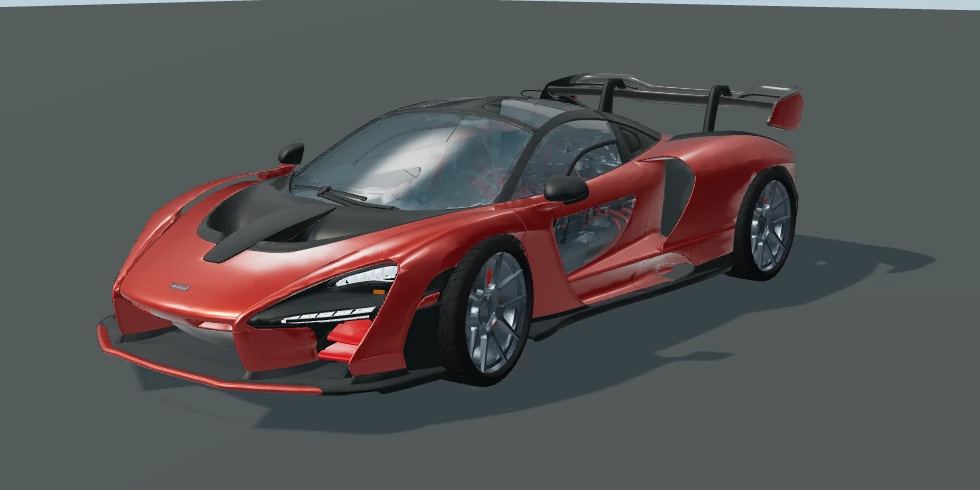
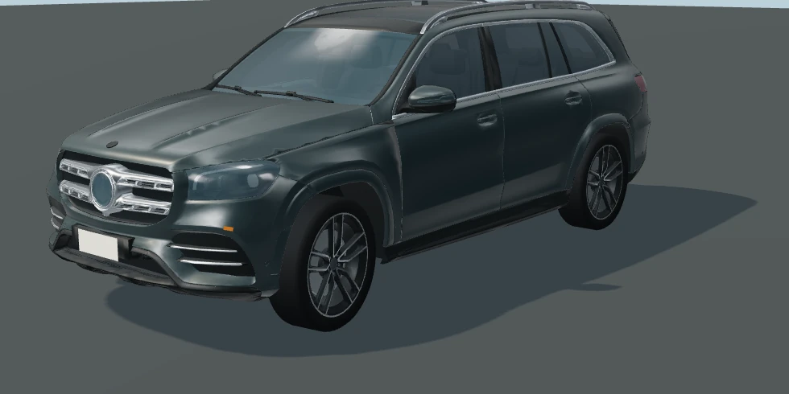

# Cars and crossing signals

These images are WebGL renders of the shipped geometry and runtime materials.
The two detailed car views use a controlled studio environment. They show asset
quality, rather than a new lighting treatment for the entire city.

## Detailed civilian cars

The two compressed model downloads total 2.8 MB. Instances share geometry and
use three geometric detail levels. At most four nearby cars use near detail on
desktop; touch devices use at most two. The game captures one static neighborhood
reflection map after loading; it does not render live reflections for each car.

The supplied source files did not include their external textures. Materials
are rebuilt in the runtime. These are substantial asset improvements, while the
reference images' texture detail, cinematic lighting, and overall scene fidelity
remain a further art and rendering effort.

## Existing Mustang and crossing signals

The Mustang rig remains in use for police vehicles and as a loading fallback.
Its before/after captures use the same camera and lighting.

## Validation

All 14 Node test files pass, including the actual compressed models, collision
footprints, road contact, steering, wheel rotation, fixed calipers, lamp states,
detail budgets, reflection assignment, and partial/total asset-load failure.

A full-city Chromium check loaded 40 cars (35 detailed civilian vehicles and five
police cars), both detailed model types, all character assets, the neighborhood
reflection, and 132 pedestrian faces. It checked signal phases and detail budgets
and reported no JavaScript or WebGL errors. The browser check uses software
rendering with reduced resolution and shadows disabled. Physical-device frame
rate and a broad gameplay session remain unverified.
