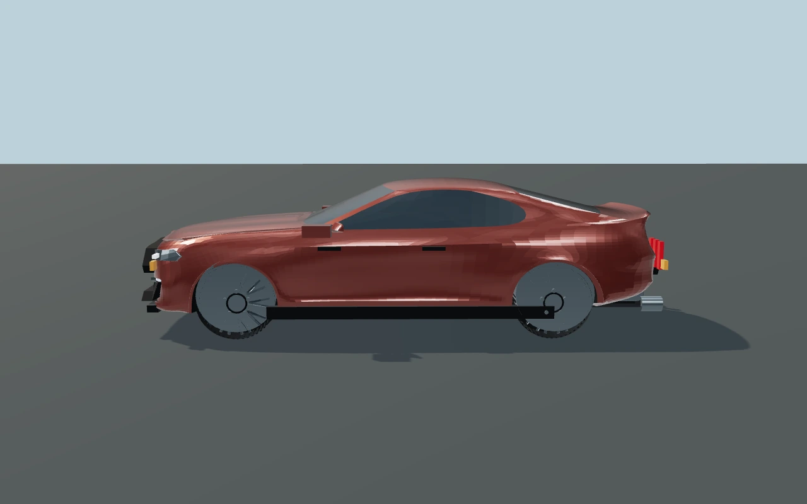
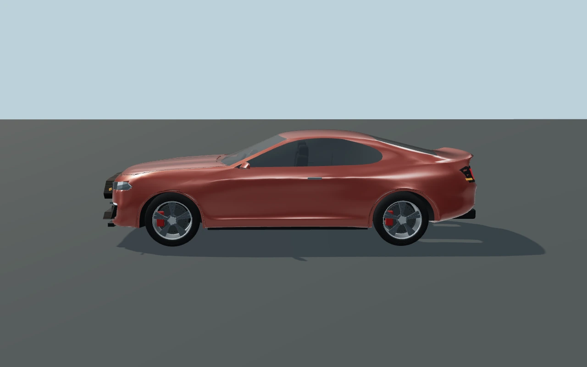
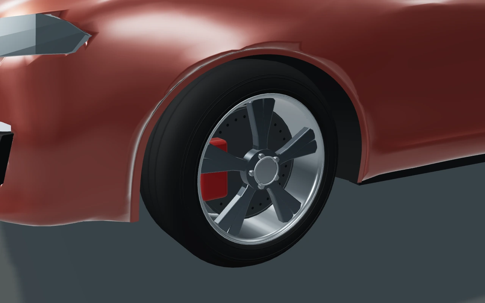
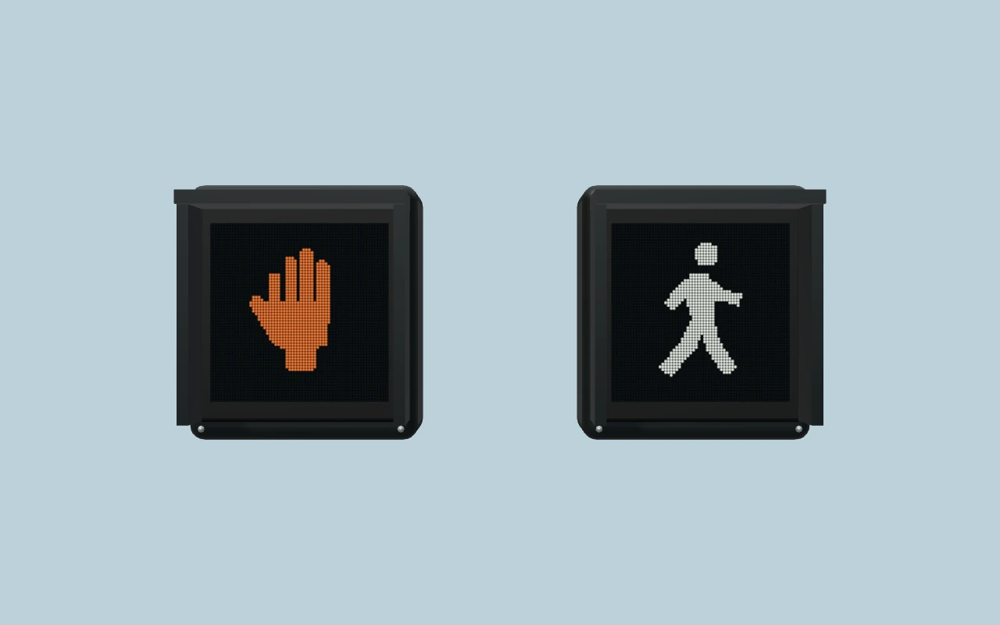

# Signals and vehicle visual review

These WebGL renders use the actual imported Mustang and runtime modules in a
controlled asset scene with the same camera and lighting for both car views.
They demonstrate asset changes; they are not a frame-rate benchmark or a claim
that the whole city has received a lighting overhaul.

## Before

## Updated

Validation: all 13 Node test suites pass. A separate full-city Chromium load
check loaded 40 vehicle rigs and 132 pedestrian faces, checked phase changes,
and reported no JavaScript or WebGL errors. The city load check used software
rendering with reduced resolution and shadows disabled; physical-device frame
rate and a broad gameplay session remain unverified.
